# V2 Frontend - Cross-Device Review

## Overview

**Scope:** Read-only first-visit review of the V2 portfolio at `http://localhost/` across five viewports, covering navigation, layout, readability, interactions, performance, accessibility, and first impression. No code was changed, no real contact message was sent, and no state-changing git command was run.

**Method:** Five isolated headless Chromium runs, one per viewport, using Playwright with `--host-resolver-rules=MAP localhost 127.0.0.1` to avoid an unrelated service bound to IPv6 `localhost`. The site was served by the Docker stack (`portfolio-web` on port 80). The `/api/contact` endpoint was intercepted and mocked for success and failure in every run. Resume and social links were inspected by href and HTTP status only. The five runs overlapped, so load timings are approximate and pessimistic.

| Device | Viewport | Input model | Result |
| --- | --- | --- | --- |
| Mobile Small | 375x667 | Touch, DPR 2 | 8 / 10, one critical |
| Mobile Large | 430x932 | Touch, DPR 3 | 7.5 / 10, two critical |
| Tablet | 820x1180 | Touch, DPR 2 | 8 / 10, no critical |
| Desktop | 1440x900 | Mouse, DPR 1 | 8 / 10, one critical |
| Wide Desktop | 1920x1080 | Mouse, DPR 1 | 8 / 10, no critical |

**Headline:** The visual system, responsive layout, modal stack, project catalog, filters, and contact success path are strong and consistent. No viewport has horizontal page overflow, and every section anchor lands with usable heading clearance. Three issues need attention before wider sharing: contact failure feedback can render outside the viewport, the mobile menu is not keyboard-safe, and the auto-scrolling project reel has no pause control and exposes duplicate cards to the keyboard. The rest are polish and accessibility-state gaps.

### Severity rubric

- **Critical:** blocks or seriously misleads a real user journey, or fails baseline keyboard accessibility for a component.
- **Minor:** visible or measurable defect with a workaround or limited blast radius.

## Device Results

### Mobile Small - 375x667 (iPhone SE class)

**What works**

- Identity lands immediately: monogram, name, role line, bio, two primary CTAs, and Resume are above the fold.
- No horizontal page scroll at any point (`scrollWidth 375` equals `clientWidth 375`).
- Every nav link lands with the heading clear of the fixed header (header bottom 78px, headings 128px to 190px).
- The open mobile menu is a clean full-screen overlay with 52px rows, correct `aria-expanded`, and Escape returning focus to the toggle.
- Reel cards open the project modal by tap; the modal has `role="dialog"`, `aria-modal="true"`, a working focus trap, scroll lock, Escape close, and focus return.
- Contact labels focus their fields, native validation blocks empty and malformed email, and success renders a clear inline confirmation. The failure alert exists, but its visibility depends on scroll position (see the cross-device contact pattern).
- Reduced motion freezes the marquee and removes the About animation.
- Skip link is the first tab stop, every tested stop has a visible outline, and the footer has a live local clock, 44px social links, and a working back-to-top control.

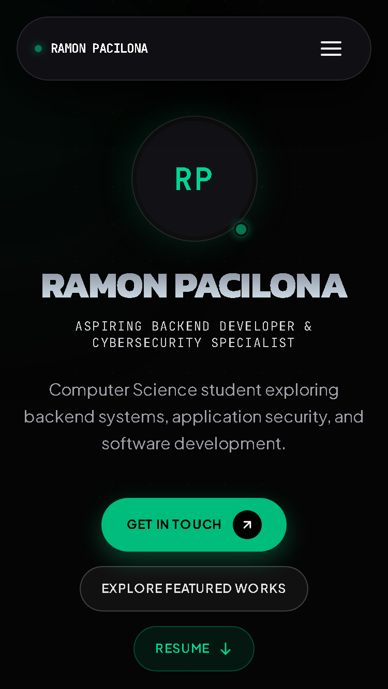

**Critical**

1. **Closed mobile menu stays in the keyboard tab order.** With `aria-expanded="false"` and the overlay at `opacity: 0`, all five links remain visible, 52px tall, `display:flex`, and `tabIndex: 0`. The intended `inert` attribute is absent from the DOM. Tab order after "Skip to content" is Projects, Tech, Experience, Certificate, Contact, then the brand and the menu button. React logs: "Received an empty string for a boolean attribute `inert`". A follow-up probe at this viewport confirmed `inertAttr: null`, `inertProp: false`, and all five links tabbable while the menu is invisible.

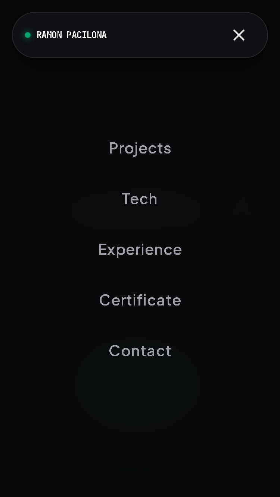

**Minor**

2. **Broken CSS3 icon (404).** Three requests to `/api/icons/simple/css3?color=1572B6` return 404, `naturalWidth 0`, rendering an empty 14x14 box in project cards.
3. **Tap targets below 44x44.** "Explore project specifications" 230x16, GitHub 58x28, "Live Demo" 79x16, "View role specifications" 190x24, "Inspect credential" 293x29, artifact controls 42x42.
4. **Meaningful labels below 12px.** Reel subtitles 9px, project status labels 10px, stack names 11px, certificate issuer and "VERIFIED" 10px, filter counts 10px. 88 sub-12px text nodes were counted.
5. **No `aria-current`.** The active section is visual only; `document.querySelectorAll('[aria-current]')` is empty at every section.
6. **Hero CTAs do not update the URL hash.** Both scroll correctly, but `location.hash` stays empty, unlike the nav links.
7. **Certificate sheen overflows its own section by 7px.** `#certificates` reports `scrollWidth 382` against `clientWidth 375`; the page clips it today, so no visible scrollbar.
8. **Load timing.** TTFB 1317ms, FCP 1444ms, LCP 1904ms, load 7385ms, CLS 0.031, one 118ms long task. Approximate because five reviews ran in parallel.

**First impression**

Confident and specific within three seconds. The dark canvas, oversized name, emerald accent, and backend/security role line read as intentional rather than templated. The page is 10,410px tall on a 667px screen, but section rhythm keeps it scannable. Score: **8 / 10**, held back by the keyboard-hidden menu and small-label polish.

### Mobile Large - 430x932 (iPhone 14 Pro Max class)

**What works**

- Strong, consistent identity across roughly 10,300px of page.
- No page-level horizontal overflow (`scrollWidth 430` equals `clientWidth 430`).
- Every hash navigation lands with 74px to 116px of clearance below the 78px floating header.
- Modals lock background scroll, trap focus, close on X and Escape, and scale project and certificate content cleanly.
- Contact success clears the form and shows a confirmation card; failure preserves values and re-enables the button; native validation focuses the invalid field.
- Inputs are 16px, so iOS will not zoom. Labels are associated and focus their fields.
- All six certificates render, Resume returns 200, and social links use `target="_blank"` with `noopener noreferrer`.
- Skip link becomes a visible 148x44 control on first Tab. Reduced motion removes reveal and float motion and freezes the reel.

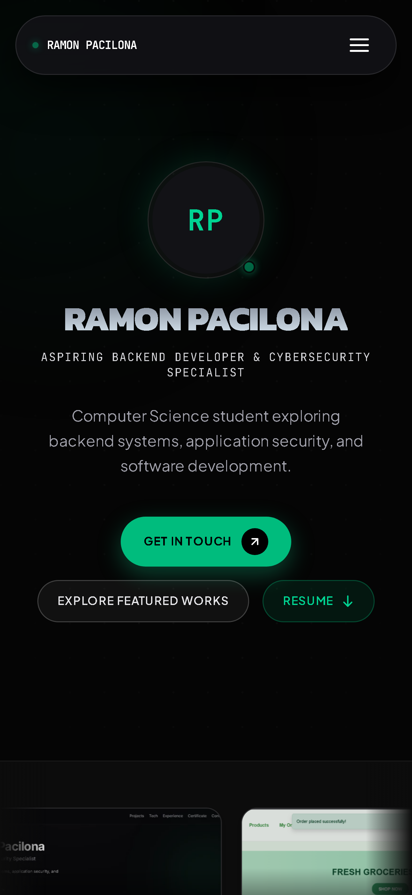

**Critical**

1. **Contact failure feedback can be invisible.** With `POST /api/contact` mocked to 500, the `role="alert"` banner measured `top: -98px`, `bottom: -44px` while the Send Message button sat at `y=502-558`. The screenshot after submit shows no visible error at all. In a follow-up probe, the banner was also offscreen at 375 (`top: -255px`) and visible at 430 (`top: 295px`) depending on scroll position, confirming that placement is scroll-dependent, not reliably visible. Users see nothing change and are likely to resubmit.

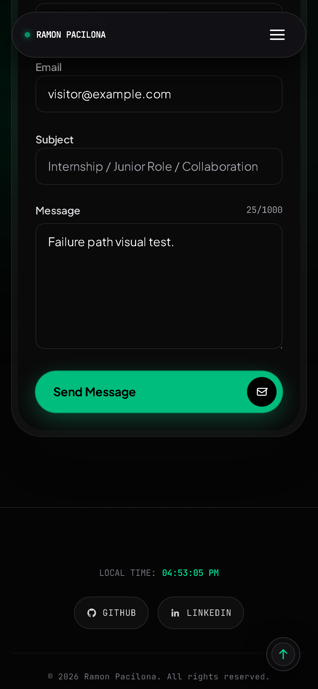

2. **Mobile menu keyboard model is broken.** The closed menu keeps `aria-hidden="true"` but five tabbable links. Opening it leaves focus on the toggle, and the next Tab goes to the hero CTA, not into the menu. There is no focus trap, and the background page scrolls behind the full-screen overlay (scrollY moved from 1200 to 1413 on wheel input).

**Minor**

3. **CSS3 icon 404.** Same 404, visible as an empty square in the Tech chip, the Studium card stack, and the Studium project modal.
4. **Tap targets below 44x44.** Project spec 230x16, "Inspect credential" 348x29, "View role specifications" 190x24, GitHub 58x28, "Live Demo" 79x16, catalog filters 71-134x28-30. Menu rows and primary CTAs pass at 44-56px.
5. **Typography.** Reel category labels 9px, project status and date labels 10px, tech chip labels 11px. Body and form text is 16px.
6. **Footer overlap.** The fixed 46x46 back-to-top button intersects the copyright line (`x=360..406`, `y=862..908` against `x=65..366`, `y=869..884`) and covers the end of "All rights reserved."

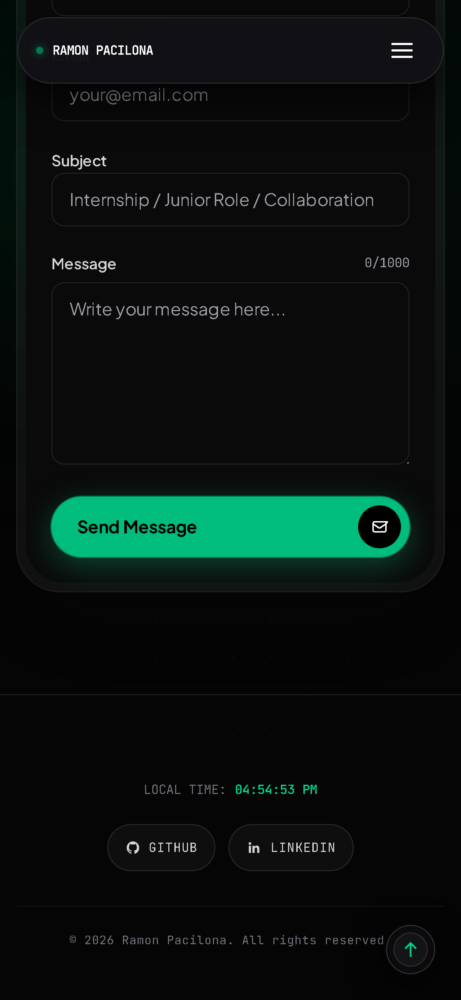

7. **Modal focus return is lost on mobile.** After closing a project, experience, or certificate modal with Escape or X, `document.activeElement` became `BODY` or a detached button rather than the opening card. Scroll lock itself restored correctly.
8. **No active nav state for assistive tech.** No `aria-current` on any nav link, and no class difference after scrolling to a section.
9. **Reel behavior is inconsistent under test.** Auto-scroll moved about 110px per 1.5s. A mouse drag from x=390 to x=70 changed card position by 0px, while the 820px run confirmed pointer and touch drag both work. Under reduced motion the track is static and clipped, and only the first card is fully visible. This needs a targeted retest before treating drag as broken.
10. **Artifacts promise inspection but only spin.** Each is a 42x42 `role="button"` with `tabindex=0` and an "Interactive 3D" label. A tap only focused it and changed its local tilt or glow; no panel or dialog appeared. Under reduced motion it may not visibly respond at all.

**First impression**

Clear within three seconds: name, role, one-line bio, and three actions. A peek of the work reel sits at the fold and invites scrolling. Score: **7.5 / 10**, held back by the contact failure path and the mobile keyboard model.

### Tablet - 820x1180 (iPad Air class, portrait)

**What works**

- No horizontal overflow. Document and body are 820/820, and every section reports equal client and scroll width.
- All five nav links reach their sections with headings 86px to 140px below the fixed header.
- The active nav item gets a clear sliding pill and emerald text.
- Resume returns 200 with `application/pdf`. Get in Touch lands at 100px and Explore Featured Works at 88px.
- The reel responds to pointer drag and real touch drag, pauses on hover, and opens the project modal on tap.
- Project cards stack cleanly with 12px offsets and clear the fixed header.
- View All Works opens a six-project catalog with status filters and a 44x44 close control.
- Project detail, catalog, lightbox, experience, certificate, and contact success views fit or scroll correctly. Body scroll locks while a modal is open.
- The lightbox layers correctly: X closes the lightbox and returns to the project modal; Escape closes the active layer, then the project modal.
- Keyboard support is solid: skip link is first and visible with a 2px emerald outline; the project modal traps focus and closes on Escape.
- Reduced motion works: marquee transform is fixed and all 577 About reveal spans remain at opacity 1.
- Contact labels, validation, mocked success, and mocked failure all behave correctly.
- Footer local time renders, social links are safe, and Back to top returns to zero.

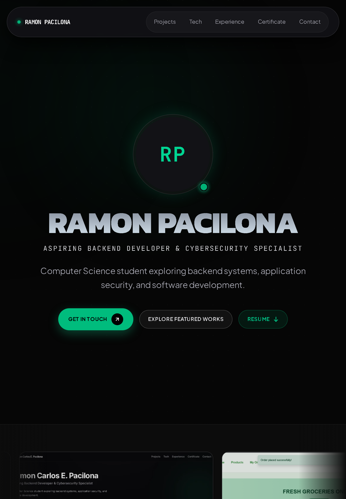

**Critical**

None observed. No blocked journey and no broken layout.

**Minor**

1. **Touch targets and navigation density.** Nav links are 40px tall, GitHub icons 58x28, and Live Demo links 79x16. This is a touch-first device showing a compact desktop nav rather than mobile navigation.
2. **CSS3 icon 404.** One blank icon in an otherwise complete 12-item Tech grid.
3. **React `inert` warning.** Console noise, and the intended inert behavior may not apply to background content while overlays are open.
4. **Small labels.** 40 meaningful text nodes under 12px, mostly 10px uppercase metadata and footer text.
5. **Filter state is visual only.** The active Tech filter is obvious, but all six pills have `aria-pressed=null`.
6. **No `aria-current` on nav.**
7. **Email placeholder is clipped.** At 820 the fields are 147px wide and the placeholder renders as `your@email.co`.
8. **Artifact affordance is ambiguous.** Tapping the Encrypted Network Node changes its tilt and glow but opens no inspection panel or label.
9. **Hero composition.** The hero uses nearly a full viewport for branding, leaving a large empty band between the CTAs and the reel. No project proof appears in the first viewport.

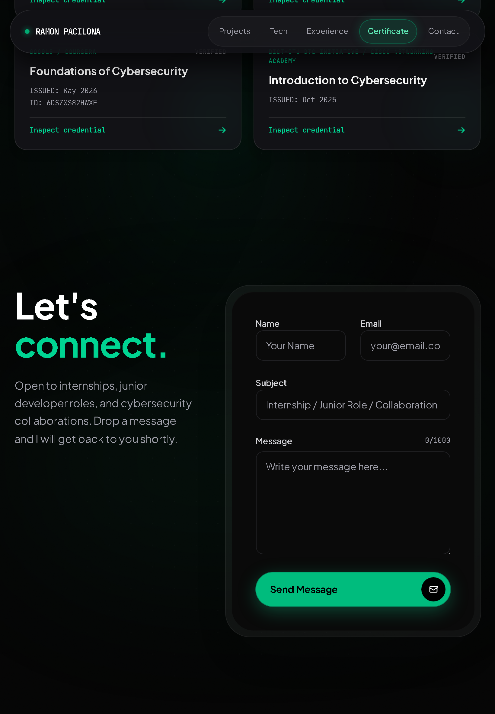

**First impression**

Strong and legible, but reads as a scaled desktop rather than a tablet-specific composition. Name, role, and Get in Touch are clear immediately. Score: **8 / 10**.

### Desktop - 1440x900

**What works**

- Above the fold: monogram, name, role, summary, three CTAs, and a self-evident nav pill.
- Nav links scroll with correct heading clearance (headings 174px to 222px against an 88px header bottom) and a clear active pill.
- LCP is the hero header at about 1.58s, CLS 0.0024, and no section overflows horizontally.
- Reel auto-scrolls, pauses on hover, drag moves it by -379px, and cards are focusable and open the modal with Enter.
- Project deck stacking is verified: tops 90/101/112/122/133 with z-index 1-5.
- View All Works opens a six-item catalog with ALL, COMPLETED, and IN PROGRESS filters.
- Modals close on X and Escape, lock and restore body scroll, and the image lightbox at z-110 works for project and certificate images.
- Contact supports required-field validation, label-click focus, a honeypot, mocked 200 success, and mocked 500 failure.
- Footer local time matches Philippine Standard Time, social hrefs are valid (GitHub 200, LinkedIn 405 to HEAD only), and Back to top returns to zero.
- Keyboard skip link is visible and jumps to `#main`; focus returns to the trigger after closing a modal. Reduced motion stops the marquee and disables the About parallax.

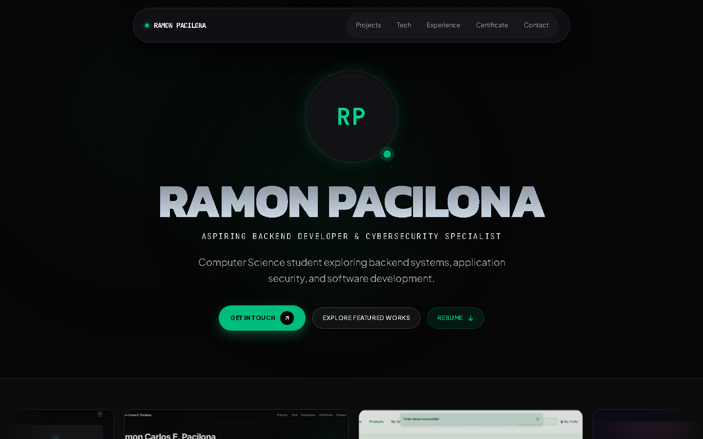

**Critical**

1. **The auto-scrolling reel has no pause and burdens the keyboard.** There are 10 tabbable reel cards for 5 unique projects, plus 4 artifact buttons, producing 14 consecutive stops before "View All Works (6)". Focusing a card does not stop motion; the track moved from -687px to -774px while a card held focus. This aligns with a WCAG 2.2.2 Pause, Stop, Hide failure. Reduced motion is the only non-hover stop. The rendered DOM exposed two tabbable groups of five while later groups were correctly `aria-hidden` with `tabindex="-1"`, which suggests the served bundle and the current source are out of sync. Rebuild before changing the component, then re-check the tab order.

**Minor**

2. **About artifacts are misleading controls.** Four `div[role="button"]` elements with `tabindex=0`, `aria-label="Interactive 3D ..."`, and `title="Click to inspect 3D core"` only perform a 650ms spin. No inspect panel, dialog, or label appears. The desktop reviewer rated this Critical; on synthesis it is a high-priority Minor because it blocks no journey, but it adds four dead tab stops and overpromises.
3. **CSS3 icon 404.** Empty outlined pill next to "CSS" in the Frontend bento row.

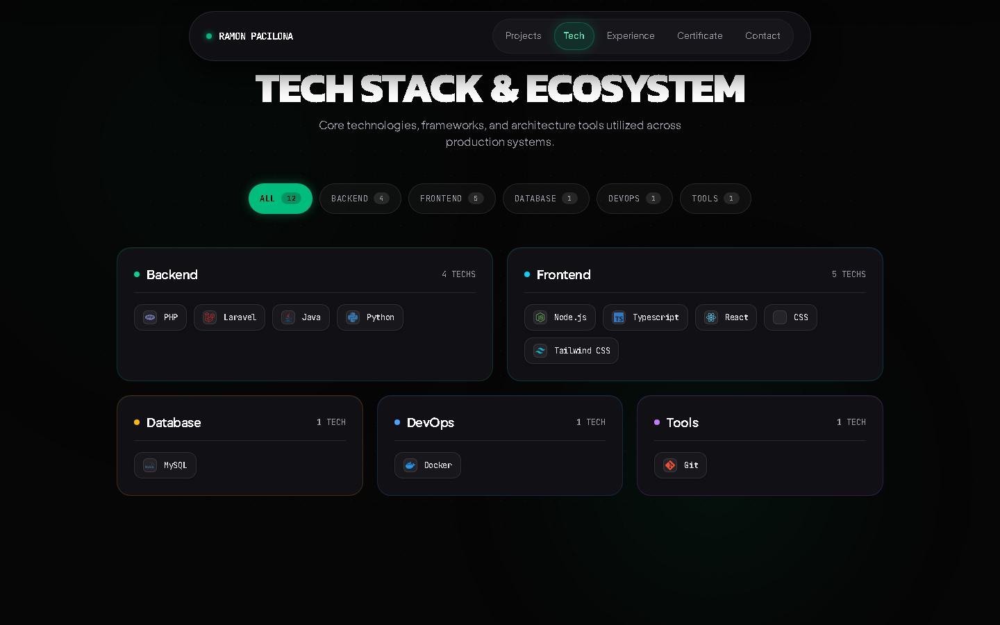

4. **React console error on every load.** "Received an empty string for a boolean attribute `inert`", traced to the hidden mobile nav overlay.
5. **About closing sentence stays dim at rest.** At the natural scroll position the final words render at opacity 0.25 and only reach full opacity after roughly 200px more scrolling. The 577-span scroll-driven reveal is also heavy DOM for one paragraph.
6. **Experience detail is thin.** "View role specifications" opens a modal with one sentence that adds little beyond the timeline row.
7. **Small and low-contrast text.** Reel subtitles 10px, project stack labels 11px, footer copyright 11px at about 4.1:1 against near-black, below AA for normal text.
8. **Targets below 44px.** Nav links 40px, project spec 230x16, role spec 190x24, credential 305x29, GitHub 58x28, Live Demo 79x16.
9. **Copy and typography inconsistencies.** Nav says "Certificate" while the section says "CERTIFICATIONS"; "A-DDoS" appears as "ADDOS" in body copy; "Outbound Operations Associate(Part-Time)" is missing a space; the COMPLETED chip is 12px while other chips are 10px.
10. **Hero CTAs do not update the URL hash.**
11. **Reduced-motion reel has no controls.** The marquee stops with a clipped card at the viewport edge, and drag is the only affordance.

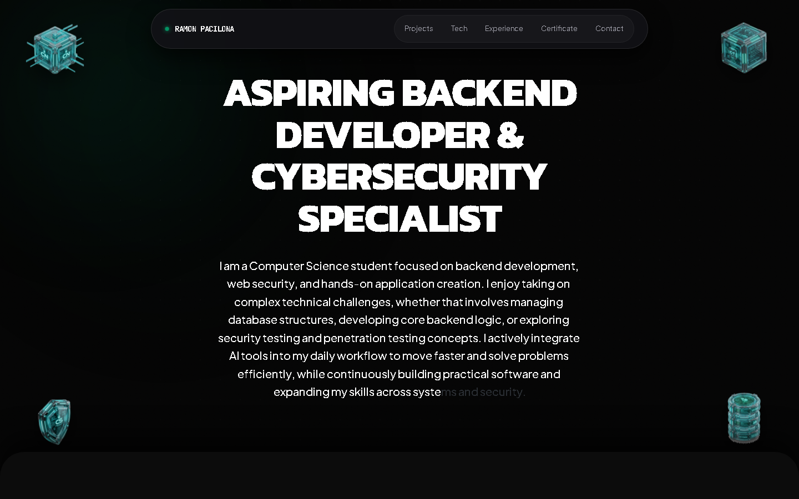

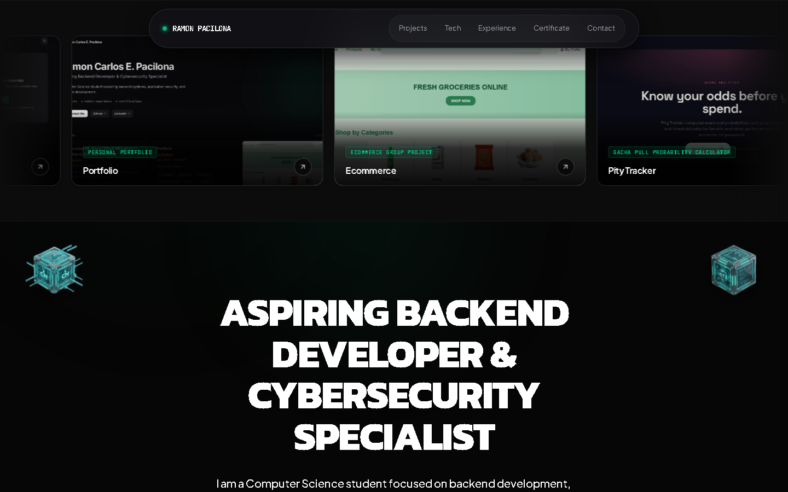

**First impression**

Strong, coherent, and immediate. Score: **8 / 10**, held back by the reel's keyboard behavior, the misleading artifacts, the missing icon, and the faded About line.

### Wide Desktop - 1920x1080

**What works**

- Clean cold load: LCP about 2.1s, CLS about 0.001, three long tasks totaling about 447ms.
- No horizontal overflow at any level; document and every section report equal scroll and client width. The only clipped content is the intentional marquee track.
- Fixed header never covers a section heading; all section titles clear the 88px header bottom.
- Content is centered and balanced: `max-w-6xl` for Tech and Certificates, `max-w-5xl` for About and Experience, `max-w-2xl` for body copy.
- Hero CTAs land with the section top at the header bottom and no clipped heading.
- Reel auto-scrolls, pauses on hover, drag scrubs 250-300px, and cards open the project modal by click and by Enter or Space.
- The project sticky stack works, the catalog opens with status filters, the detail modal and lightbox layer correctly, and body scroll locks and releases.
- Tech filters work; selecting FRONTEND reduces the bento to the Frontend card.
- Contact labels focus fields, native validation fires, mocked success shows "Message Sent!", and mocked failure shows an error.
- Footer time, social links, and Back to top work.
- Skip link is first, focus outlines are consistent, modals trap focus, and Escape closes them.
- Reduced motion holds the reel static and keeps the reveal text at full opacity.

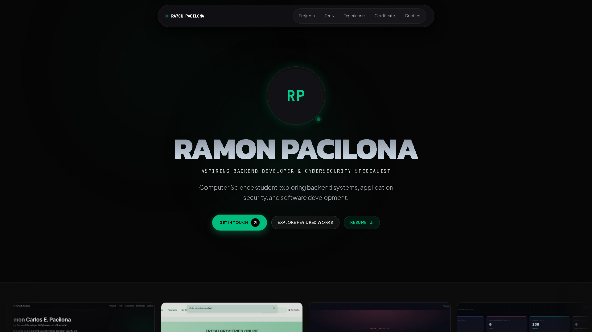

**Critical**

None found. No blocked journey, horizontal scroll, broken layout, or dead-end flow.

**Minor**

1. **CSS3 icon 404.** One missing logo in the Frontend row.
2. **React `inert` warning.** Real attribute-value bug, not just noise.
3. **Text below 12px.** 10px reel subtitles (58 instances) and 11px modal tech names and stack labels (40 instances).
4. **Targets below 44x44.** Nav links 40px, GitHub 58x28, Live Demo 79x16, role spec 190x24, credential 305x29. The project spec link has a card-wide `::after` hit area, so its real click area is larger.
5. **Nav active state is color-only.** No `aria-current` and no indicator element.
6. **Projects anchor lands under the header.** After clicking Projects, the target top is 32px while the header bottom is 88px; the "FEATURED WORKS" heading itself is clear at 96px, but the rounded panel top is partly hidden.
7. **Hero CTAs do not update the URL hash.**
8. **Reel clicks can be swallowed mid-scroll.** A click on a card that has not been hovered first does nothing; resting the pointer pauses it and then the click works.
9. **Lightbox is not a semantic dialog.** The z-110 overlay has no `role="dialog"`, no `aria-modal`, and no label. Project modals do expose `role="dialog"` and `aria-modal="true"` via the shared Modal shell.

**First impression**

Clear and confident: name, role, nav, bright Get in Touch, and Resume. The hero is text-only, with no photo and no explicit availability badge beyond the pulsing dot. Score: **8 / 10**.

## Cross-Device Patterns

### 1. Visual identity is the strongest asset

Every viewport reads as the same product: near-black canvas, emerald accent, oversized display type, mono metadata, restrained glow. First impression scores cluster at 8/10. The role line, name, and CTAs are legible within three seconds at every size. The 820px composition is the outlier because it spends almost a full viewport on branding before showing work.

### 2. Layout engineering is solid

- Zero horizontal page overflow at 375, 430, 820, 1440, and 1920.
- `max-w-*` constraints keep line lengths readable on wide screens.
- The fixed header never covers a section heading after nav, with one exception: the Projects anchor at 1920 starts 48px above its section and tucks the panel top under the header.
- Modals, the catalog, the lightbox, and the sticky project deck hold up across widths.
- Narrow contact forms are the only place where a state change can render outside the viewport.

### 3. Keyboard and accessibility gaps cluster in three components

**Mobile menu (375, 430, all widths below `md`)**

- Closed overlay: `opacity: 0`, `pointer-events: none`, but five tabbable links and no `inert`.
- Root cause: `inert={!menuOpen ? '' : undefined}` in `Header.jsx`. React treats the empty string as false and drops the attribute, producing the console warning.
- Open overlay: focus stays on the toggle; the next Tab goes to hero content; there is no focus trap; the page scrolls behind the overlay.

**Reel (1440 verified, likely all widths)**

- 10 tabbable cards for 5 unique projects.
- Auto-scroll continues while a card has focus.
- No pause, stop, or hide control.
- Reduced motion stops motion but leaves a clipped track with no explicit controls.

**State semantics**

- No `aria-current` on any nav link at any viewport.
- No `aria-pressed` on Tech filter pills.
- Lightbox lacks dialog semantics and a focus trap.
- Modal focus return is inconsistent: works at 1440, returns focus to BODY or a detached node at 430.
- About artifacts announce themselves as interactive buttons but only spin.

### 4. Contact feedback is good on success and fragile on failure

- Success replaces the form with a clear confirmation card and clears fields.
- Failure preserves values and re-enables the button.
- The failure banner is inserted at the top of the form and is not scrolled or focused into view. It was invisible at 430 in the recorded run and at 375 in a follow-up probe, while visible at 820 and 1440. The result depends on the user's scroll position when they submit.

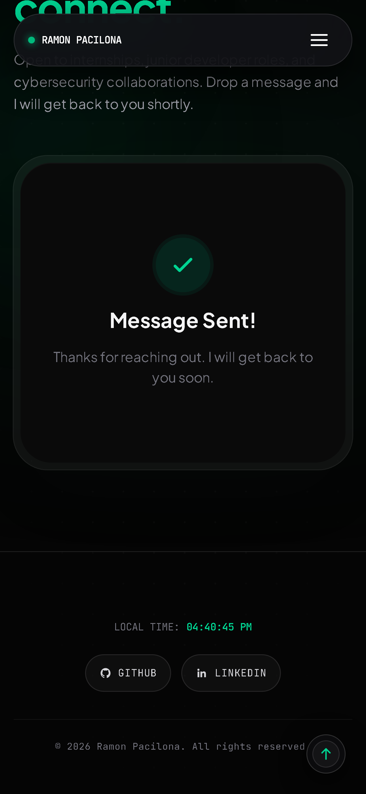

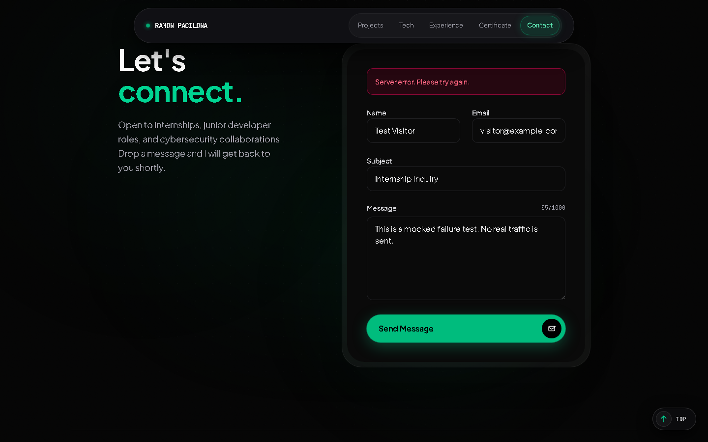

### 5. Small-screen polish is the main visual debt

- Tap targets: project spec, GitHub, Live Demo, role spec, credential, and some catalog filters fall well under 44x44. Text controls have card-wide `::after` hit areas on project cards, so their effective target is larger than the measured text box.
- Typography: 9px to 11px labels are used for meaningful metadata across reel, projects, certificates, and footer.
- 430 footer: the fixed back-to-top control overlaps the copyright line.
- 820 contact: the email placeholder clips to `your@email.co`.
- Every width: the CSS3 icon returns 404 and leaves a blank chip.

### 6. Performance is acceptable, not a blocker

| Viewport | TTFB | LCP | CLS | Notes |
| --- | --- | --- | --- | --- |
| 375 | 1317ms | 1904ms | 0.031 | Load 7385ms, one 118ms long task |
| 430 | 1111ms | 1848ms | 0.077 | 571KB across 82 requests, 7 long tasks, max 288ms |
| 820 | 1073ms | 1484ms | 0.086 | 4 long tasks, max 60ms |
| 1440 | not recorded | about 1580ms | 0.0024 | LCP is the hero header |
| 1920 | not recorded | about 2100ms | about 0.001 | 3 long tasks, about 447ms total |

Load events of 7 to 10 seconds were measured while five agents hit the same host in parallel. Treat them as a stress signal, not production numbers. The useful signal is that LCP is consistently in the 1.5s to 2.1s range and CLS stays below 0.09. The 375 run loaded 74 images, and the 430 run made 82 total requests for 571KB, so image prioritization and caching are the obvious next performance pass.

### 7. Copy and interaction consistency

- "Certificate" in nav versus "CERTIFICATIONS" in the section.
- "A-DDoS" in reel metadata versus "ADDOS" in body copy.
- Missing space in "Outbound Operations Associate(Part-Time)".
- Status chip sizing is inconsistent: COMPLETED 12px, other chips 10px.
- Hero CTAs scroll without updating the hash; nav links update it.
- The "View All Credentials" button is conditional on more than six certificates. With exactly six, it correctly does not render, so the modal is reachable only if the data grows.

## Priority Fix List

### Critical

| Rank | Issue | User impact | Devices affected | Suggested direction |
| --- | --- | --- | --- | --- |
| 1 | Contact failure feedback can render outside the viewport | A failed send looks like nothing happened, so users resubmit or assume the form is broken | 430 confirmed, 375 reproduced; likely any narrow or short viewport | Place the alert next to the submit button, or scroll and focus it on error. Keep `role="alert"` and add a visible focus ring. |
| 2 | Mobile menu is not keyboard-safe | Five invisible tab stops; after opening, Tab skips the menu; background scrolls behind the overlay | All widths below `md`, confirmed at 375 and 430 | Use a boolean `inert={!menuOpen}` (or `hidden` plus `tabIndex={-1}`), move focus into the menu on open, trap Tab, lock body scroll, and restore focus on close. |
| 3 | Reel auto-scroll has no pause and duplicates keyboard stops | Keyboard and motion-sensitive users cannot stop moving content; 10 stops for 5 projects | 1440 verified, likely all widths | Add a visible pause/play control, pause on focus and hover, and remove duplicate groups from the accessibility tree in every rendered copy. |

### High-priority minors

1. **About artifacts overpromise.** Either implement a real inspect view or remove `role`, `tabIndex`, the `aria-label`, and the "Click to inspect 3D core" title. Four dead stops per page at 430, 820, and 1440.
2. **Nav and filter state.** Add `aria-current="page"` or `aria-current="location"` to the active nav link and `aria-pressed` to Tech filters.
3. **Lightbox semantics.** Add `role="dialog"`, `aria-modal="true"`, a label, and a focus trap, or reuse the shared Modal shell.
4. **Modal focus return.** Verify the opener is still mounted when cleanup runs; on mobile it currently returns to BODY.
5. **CSS3 icon 404.** Fix or remove the `/api/icons/simple/css3` request. It is the only visibly broken image at every width.
6. **`inert` console error.** Fixing the mobile menu removes this warning and the hidden-tab-stop defect in one change.

### Polish

1. Raise meaningful labels to at least 12px, especially reel subtitles, project status, certificate issuer, and footer metadata.
2. Expand secondary touch targets to 44x44, or document that the card-level `::after` overlay is the real target.
3. Fix the 430 footer overlap by reserving bottom space or moving the back-to-top control clear of the copyright line.
4. Update the hero CTA handlers to push the matching hash after scrolling, so hero and nav behavior match.
5. Adjust the Projects nav offset so the panel top clears the header at 1920.
6. Give the contact email field more width at 820, or shorten the placeholder.
7. Raise the About closing line's resting opacity so the sentence is readable without extra scrolling.
8. Normalize copy: Certificate versus Certifications, A-DDoS versus ADDOS, the missing space before "(Part-Time)", and chip sizing.
9. Add explicit previous/next controls or a scrollable track for the reduced-motion reel.
10. Revisit the hero composition at 820 so some project proof appears in the first viewport.

## Recommendations

1. **Fix the three critical items first, as one accessibility pass.** The menu and reel defects share a root cause pattern: visual state is correct while the accessibility tree and focus model are not. Fixing `inert`, focus entry and return, pause-on-focus, and duplicate removal will remove most of the keyboard debt in one change.
2. **Make error feedback impossible to miss.** After a failed submit, focus and scroll to the alert, or render it inline beside the button. Test at 375 and 430 with the page scrolled to the button, not just at desktop.
3. **Add a keyboard and reduced-motion smoke test to CI.** A Playwright check that tabs from the top should never enter `#mobileNav` while closed, should enter it when open, and should find a pause control for the reel. Run it at 375, 820, and 1440.
4. **Add axe or an equivalent automated accessibility check.** It would catch missing `aria-current`, missing dialog semantics, and possibly the `inert` value problem. Automated checks will not catch the scroll-dependent contact banner, so keep the manual case.
5. **Treat the 44px target and 12px label rules as design tokens.** Several controls already use `min-h-[44px]`; extend that to nav links, GitHub, Live Demo, role spec, and credential triggers. Reserve sub-12px type for decorative metadata only.
6. **Do one image and icon pass.** Fix the CSS3 404, confirm every icon endpoint returns 200, and prioritize the hero image or text for LCP. The current 571KB and 82 requests are reasonable but leave room to tighten.
7. **Re-run this same matrix after fixes.** Use 375x667, 430x932, 820x1180, 1440x900, and 1920x1080, with mocked contact success and failure, keyboard-only navigation, and reduced motion. Compare against this report rather than starting from a new checklist.
